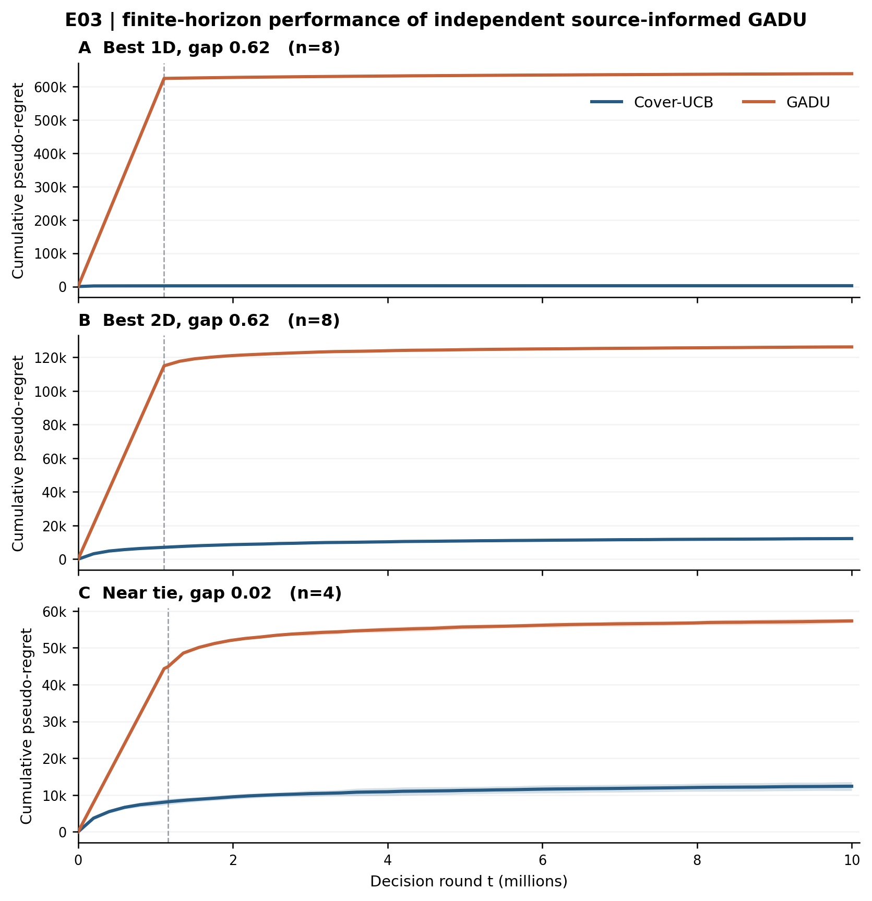
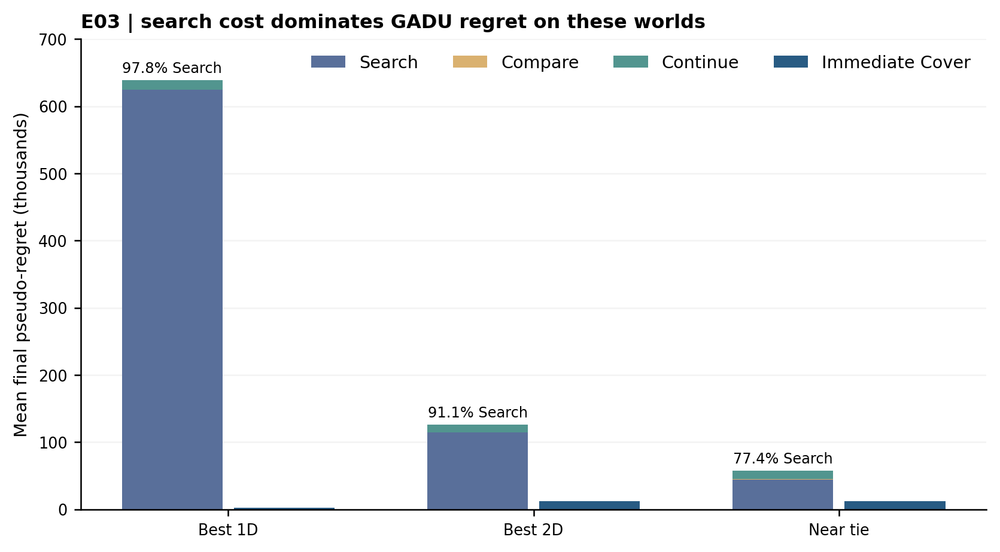
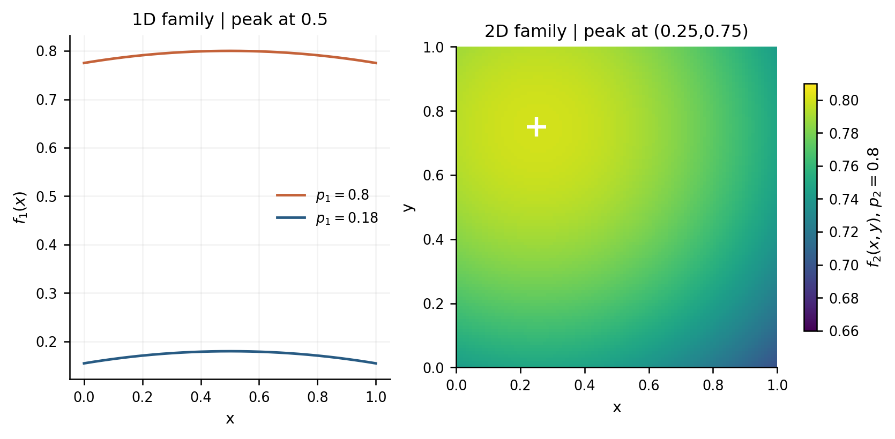

# WWW 2027 / GADU — E03 figure & data MVP (24 Oct 2026)

> **Coauthor review candidate — NOT an author-validated experiment or approved manuscript figure.** This is a publication-oriented, reproducible package of an **already completed**, independently implemented, manuscript-informed experiment. **No new full-horizon simulations were run for this package.** The tested code has not been signed off as equivalent to the final author algorithm. E03 is a **post-hoc correction** to E02 (coarse-grid retaining in the relevant stage transitions; not a fully nested hierarchy across all radii).

## Open / download first

| Figure | GitHub preview | PDF for LaTeX | Vector SVG | High-res PNG |
|---|---|---|---|---|
| **1. Cumulative latent pseudo-regret R(t)** (three worlds, paired seeds) | [Preview](figures/fig1_cumulative_regret.png) | **[PDF](figures/fig1_cumulative_regret.pdf)** | [SVG](figures/fig1_cumulative_regret.svg) | [PNG](figures/fig1_cumulative_regret.png) |
| **2. Regret by Search / Compare / Continue** | [Preview](figures/fig2_stage_decomposition.png) | **[PDF](figures/fig2_stage_decomposition.pdf)** | [SVG](figures/fig2_stage_decomposition.svg) | [PNG](figures/fig2_stage_decomposition.png) |
| **3. Synthetic reward functions** | [Preview](figures/fig3_reward_functions.png) | **[PDF](figures/fig3_reward_functions.pdf)** | [SVG](figures/fig3_reward_functions.svg) | [PNG](figures/fig3_reward_functions.png) |

**[Download the compact figures + methods package](E03_COAUTHOR_FIGURES_DATA.zip)** (PDF/SVG/PNG + Methods, raw/summary CSV and reproducible plotting script). Each figure is also embedded here for immediate review:







## What was tested?

**Environment:** two clipped-quadratic synthetic action families on `[0,1]` (1D) and `[0,1]^2` (2D):

$$
f_1(x)=\operatorname{clip}(p_1-0.10(x-0.5)^2,0,1),
\quad f_2(x,y)=\operatorname{clip}(p_2-0.09((x-0.25)^2+(y-0.75)^2),0,1).
$$

Three worlds differing in `(p1,p2)`:

| World | Peak parameters | Gap | Independent paired seeds |
|---|---|---:|---:|
| Best 1D | (.80, .18) | .62 | 8 |
| Best 2D | (.18, .80) | .62 | 8 |
| Near tie | (.80, .78) | .02 | 4 |

**Protocol:** T=10,000,000 decisions, K=2, dimensions (1,2), q_w=.75, attribution window w=1, Lipschitz L=.3, gamma=1. Bernoulli positive events: delay 1 with probability .75 and delay 4 with probability .25; failed conversions never report. The pseudo-outcome `Y=Z * 1[D<=1]/.75` is used after maturation. Both GADU and immediate Cover-UCB act at every one of the T rounds, although their exploration budgets are **not** equal. The potential outcomes are keyed by common `(seed, absolute t, tagged physical arm, randomness channel)`; different chosen actions do not guarantee identical realized noise. Source-informed **independent** GADU implementation uses Search → Compare → acceptance check → fresh continuation. The Cover-UCB baseline uses original-horizon optimized immediate fixed covering.

## Results: lower cumulative pseudo-regret is better

| World | Cover mean | GADU mean | Paired GADU minus Cover | 95% paired t CI (conditional on this world) | Certificate |
|---|---:|---:|---:|---|---|
| Best 1D | 2,444.37 | 638,590.92 | **+636,146.55** | [635,457.45; 636,835.65] | 8/8 correct |
| Best 2D | 12,267.84 | 126,135.90 | **+113,868.06** | [113,026.27; 114,709.85] | 8/8 correct |
| Near tie | 12,397.11 | 57,308.91 | **+44,911.80** | [44,114.09; 45,709.51] | no certificate 4/4 |

The result is **negative for GADU in all 20 archived pairs**. The decisive post-hoc diagnostic: **Search-only regret already exceeds full immediate-Cover regret for 20/20 pairs** (mean ratios 255.45× / 9.37× / 3.58×). Under these **frozen** parameters, an independent exhaustive scan of all 48,341 candidate Compare rounds shows the economic gate **cannot reject any strictly separated family**: the acceptance branch is structurally unreachable. Thus this study measures expensive initial Search much more than general value of certification. It does not prove universal inferiority, falsify the analytical upper-bound theorem, or determine crossover T.

## What can / cannot go into WWW 2027

**Safe as coauthor-reviewed preliminary finding:** selected-world finite-horizon Search cost, correct family identification in strong gap, no certificate on near-tie, pairwise endpoint contrasts and post-hoc limitations. **Not safe to call author-original GADU, a clean prospectively preregistered replication, a real-world online policy test, or validation/refutation of its theorem.** The manuscript snapshot SHA256 `9a196140a7b600d578f69240a0a1a7638299da651728e376a46c4caa10a35b81` previously said *“GADU is not evaluated”* in its original, different three-family HOO/Zooming baseline section. **Ilgham and coauthors must confirm the final manuscript and policy implementation and approve any insertion.** See [Methods, Results, captions, and open questions](CAPTIONS_METHODS_RESULTS.md) and [adversarial audit](REVIEW_GATES.md).

**Anonymity caution:** this is a public account-identifiable repository. For double-blind submission do not cite a non-anonymous GitHub link as a reviewer supplement unless the coauthors confirm it complies with track policy; anonymize/rehost approved material where necessary.

## Reproduce without rerunning 10M decisions

```bash
python -m pip install numpy scipy matplotlib
python code/plot_figures_from_csv.py
python code/red_team_falsification_e03.py
python code/independent_h2_h3.py  # independent short diagnostic; needs numba
```

The first command reads [all 2,080 archived per-seed trajectory observations](data/e03_per_seed_trajectory_checkpoints.csv), [original E03 seed rows](data/e03_seed_runs.csv) and [summary](data/table_e03_final.csv); checks endpoints/time/stages and regenerates PDF/SVG/PNG figures in `regenerated/`. Time checkpoints are **archived policy observations, not endpoint-interpolated curves**. Shading denotes **pointwise individual-policy 95% seed-conditional t intervals**, not paired time-difference bands or simultaneous coverage. Generator output need not be binary-identical across plotting-library versions. Test and original program source are in [code](code/); inputs are in [data](data/). Rerunning `experiment_nested.py` would take new 10M-round trials and is **not necessary** to rebuild these charts.

**Verification:** original archived 31/31 SHA256 component integrity pass; 20/20 seed records, 40/40 trajectories and final endpoints, 2,080 checkpoints, stage regret accounting; short-clock test 96 Search + 288 Compare and six admissible geometric covering checks locally passed. This does **not** validate original authors' implementation or fill missing economic-rejection branch. Check [SHA256SUMS.txt](SHA256SUMS.txt) for the exact published artifact bytes.

## Primary scientific contact / decision needed

Please review **Figure 1 and its test functions first**. Does this exploratory negative cost diagnostic belong in the paper or only in the supplement? Is this source-informed independent implementation equivalent to the **actual final author pseudocode** (event-clock maturity, first strict-separation gate, economic acceptance/rejection, and fresh fallback/continuation)? No source parity or manuscript approval has yet been granted. We are deliberately not modifying the author-controlled TeX.
