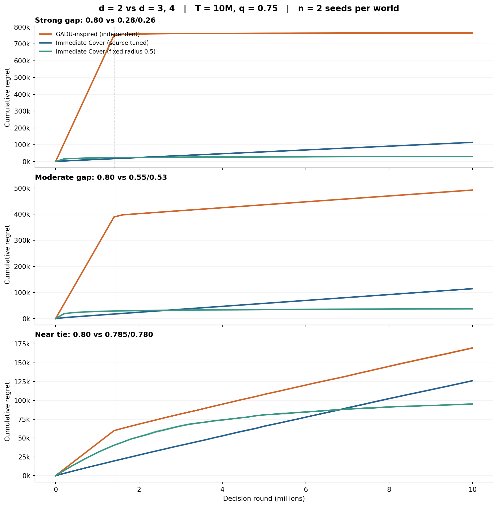
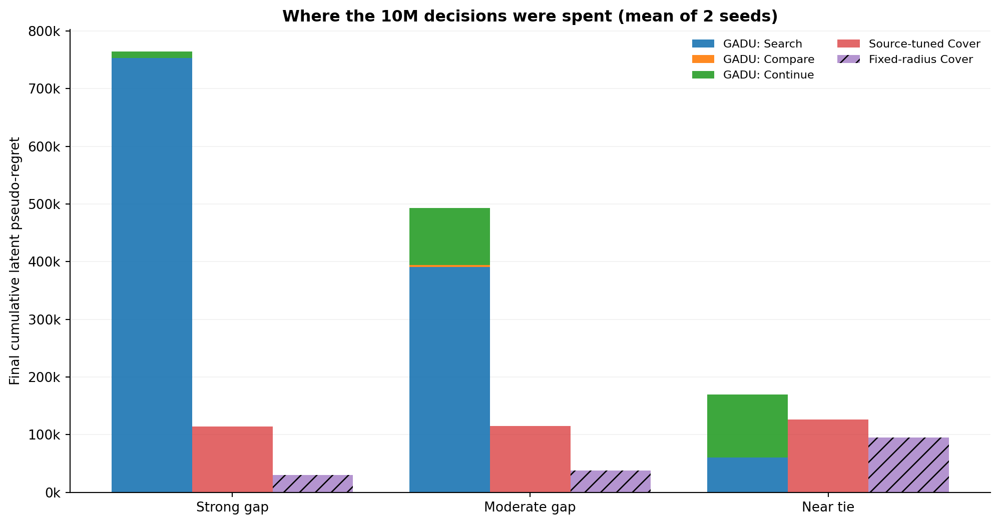

# E06 / Ilgham's suggestion — dimension 2 vs dimensions 3 and 4

**24 October 2026 — exploratory replication of a coauthor's suggested scenario.** This folder is *not* an approved evaluation of the authors' final GADU implementation, an independently pre-registered confirmatory experiment, or an insert-ready paper result.

## Immediate visuals





*The PDF versions are intended for LaTeX download, not GitHub's sometimes broken embedded PDF preview.*

- [Download Figure 1 PDF](d234_cumulative_regret.pdf) | [PNG](d234_cumulative_regret.png)
- [Download Figure 2 PDF](d234_stage_decomposition.pdf) | [PNG](d234_stage_decomposition.png)
- [Raw 6-run JSON](d234_raw.json) | [CSV](d234_raw.csv) | [51-time-checkpoint-per-run traces](d234_trajectories.json) | [summary CSV](d234_summary.csv)
- [Frozen before-run protocol](d234_pilot_lock.json) | [independent numerical audit](d234_audit.json) | [short event-clock test results](d234_short_test_report.json)

## Experimental question

Can certification reduce waste on higher-dimensional, inferior families relative to immediate Cover-UCB when the true best family has dimension **d=2**, with other candidate families of **d=3 and d=4**?

**Design:** K=3, domains `[0,1]^2`, `[0,1]^3`, `[0,1]^4`; all latent means are clipped quadratics
`mu_i(x) = clip(p_i - 0.09 ||x-c_i||_2^2, 0, 1)`.
Good 2D center `(0.25,0.75)`; inferior 3D/4D centers at `(0.5,...,0.5)`; all are Lipschitz with L=0.3. `T=10,000,000`, q=0.75, attribution w=1, successful-event delay 1 with probability 0.75 or delay 4 otherwise; failures silently unreported.

Three selected peak triples are `strong_gap=(.80,.28,.26)`, `moderate_gap=(.80,.55,.53)` and `near_tie=(.80,.785,.780)`. Fixed before new outcomes were generated in `d234_pilot_lock.json`; 2 seeds each (6 full-horizon policy pairs), no exclusions. **This is exploratory even though the seed/config lock precedes the six runs, because the scenario family itself was chosen after E03/E04 evidence.**

Source-informed independent implementation extends the existing two-family Search -> Compare -> Accept/Fallback -> fresh Cover continuation to 3 families. `C=(1,2,3)` is the chosen Euclidean-cover *envelope* for the generated physical grid (not the old E03 C=1/1); actual Search net has 113 physical arms (5/27/81), consistent with C's radius-specific cardinality limits. The source formula chooses `eta_T=1`, search `rho=5/12`, one-shot total Search duration **1,405,043 rounds**. All 10M rounds are counted. Original manuscript/author-code parity is **BLOCKED**.

**Primary baseline** is the source-certificate tuned immediate Bernstein Cover-UCB. At T=10M the formula selects `rho=1` and the actual grid contains only **three arms, one in each family**. It does *not* perform a high-dimensional detailed search; therefore the hoped-for explanation of baseline failure does **not** hold for the main fair comparator in this setup. **Secondary diagnostic** is an immediate Cover-UCB with fixed `rho=0.5` (30 arms, 4/9/17), **not** source-tuned and never substituted for the primary baseline.

## Frozen outcome (mean across two seeds; lower regret is better)

| World | Independent GADU | Immediate source-tuned Cover | GADU minus source-tuned Cover | Fixed-rho Cover diagnostic | Family certified |
|---|---:|---:|---:|---:|---|
| Strong gap | 764,552.10 | 113,892.51 | +650,659.60 | 29,789.31 | best 2D, 2/2 |
| Moderate gap | 492,618.83 | 114,580.53 | +378,038.30 | 37,378.80 | none, 0/2 |
| Near tie | 169,753.82 | 126,166.74 | +43,587.08 | 95,231.69 | none, 0/2 |

All **6/6** have greater cumulative latent pseudo-regret for the GADU-inspired independent implementation versus both baselines. In strong/moderate worlds Search alone already exceeds the *entire source-tuned baseline final regret* for **4/4** pairs. In near-tie worlds Search is lower but no certificate is issued. The coarse source-tuned Cover 2D optimum at `(.25,.75)` is **not** in its `rho=1` grid; its fixed-grid approximation error contributes a nonzero R(t) slope, and this is accounted for rather than treated as a learning failure.

**Correct interpretation:** Under these three pilot-informed worlds at this horizon, greater dimensionality of inferior families does **not** suffice for this GADU-inspired policy to beat either Cover variant. This is not a general ranking, author-algorithm theorem test, nor an estimate of what will happen at other T or cover geometries. `n=2` per cell is not statistically adequate for confidence intervals or world-generalization.

## Methods / reproduction

`numpy` and `numba` are required for the original-style simulator; `matplotlib` for figures. No new external data.

```bash
python -m pip install numpy numba matplotlib
python test_d234_short.py      # 320 pure-Python vs Numba RNG comparisons; 24 Search and 72 Compare tests
python audit_d234.py           # stdlib/Fraction analytic regret and accounting for all frozen results
python d234_trajectory.py      # 6 full policy trace replays; checks final R(T) against raw runs
python d234_figures.py         # PDF/PNG from actual 51-point trajectories, not endpoint interpolation
python d234_pilot.py           # optional: FULL 6 x 10M rerun, overwrites regenerated raw JSON
```

`d234_pilot.py` writes metadata (code, preflight, lock SHA256); `d234_audit.json` is an *independent arithmetic* validation of the original runs, not an independent full scientific implementation. All 6 per-policy time series were replayed at global rounds 0,200k,...,10M and reconciled with original seed-specific endpoints. Curves show empirical means over **two** seeds, without spurious confidence ribbons. 

## Next discriminating experiment (not run here)

Ask Ilgham to approve the authoritative 3-family pseudocode/cover constants and select a regime where **source-tuned Cover actually chooses a fine net** (not just one arm per family). Pre-register dim2 optimum shifts, peak gaps, source-specific T/q/w retuning, physics of high-dimensional geometry, held-out world/seed distribution and fair comparisons. Then verify that Search's deterministic regret floor allows any improvement at all *before* spending full-horizon simulation compute.
