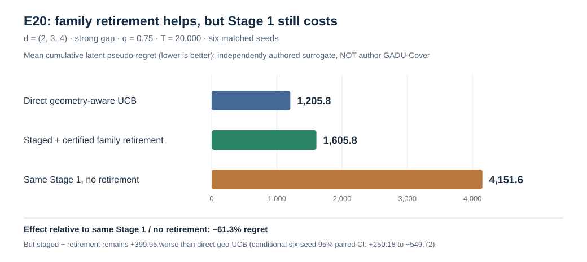

# Ильгам: что мы сделали по твоему вопросу о размерностях?

**Обновлено 26 октября 2026 | Статус: исследовательский отчёт для проверки соавторами, не результат для статьи.**

> **Суть твоего вопроса из переписки 24 октября (не дословная цитата):** провести эксперименты с семействами разных размерностей — лучшее `d=2`, остальные `d=3,4` — и проверить предположение, что Search / Compare / выбор хорошего семейства экономит суммарный regret по сравнению с UCB, исследующим все семейства. **При каких условиях наш алгоритм действительно оказывается лучше?**

## Ответ за 30 секунд

**Мы проверили предложенный механизм — да. Показали, что актуальный авторский GADU выигрывает у корректного UCB — нет.**

1. Запустили **именно `d=(2,3,4)`** с лучшим семейством `d=2`, а также равномерные размерности и несколько других вариантов. Построили модели с сильным / средним / малым разрывом наград и задержанными положительными наблюдениями.
2. Для одной наиболее информативной конфигурации `E20: d=(2,3,4), T=20 000, q=.75` получили **1 605.8 regret с исключением плохих семейств против 4 151.6 без исключения при идентичном Stage 1**. Это **−61.3%**, то есть гипотетический выигрыш от *retirement* действительно существует относительно этого контролируемого алгоритма.
3. Но **прямой адаптивный Geometry-UCB получил 1 205.8**, лучше нашего staged-алгоритма на **399.95 regret**. Более того, в E20 **ни одна экспериментальная ячейка с выданным сертификатом не обошла Geometry-UCB по среднему regret**.
4. **Самое важное ограничение:** E13–E20 проверяют **наши независимые GADU-inspired алгоритмы**, НЕ твою финальную GADU-Cover реализацию с полным preflight, covers, gating/fallback и fresh restart. Твою обновлённую адаптацию Stage 1/2 мы ещё не проверяли. Следовательно, вывод **не опровергает и не подтверждает** теорему или качество твоего авторского алгоритма.

**Вердикт:** показали, **что исключение высокоразмерных плохих семейств может экономить regret**, но **не нашли достоверного режима, в котором эта экономия покрывает всю цену двухэтапной процедуры по сравнению с сильным адаптивным конкурентом**. Условия победы именно твоего GADU пока неизвестны.

## 1. Задача → эксперимент → результат

| Что ты хотел проверить | Что мы сделали | Что получилось |
|---|---|---|
| Лучшее семейство `d=2`, другие `d=3,4` | **E06**, затем **E13/E17/E18/E19/E20** | Эти размерности действительно протестированы |
| Плохие 3D/4D тратят бюджет UCB | **E06** проверил source-tuned Cover; **E17/E20** сравнили другие UCB и no-retirement | **E06:** у source-tuned Cover всего 3 действия, поэтому ожидаемого перерасхода на высокие размерности в этом режиме нет |
| Search+Compare → сертификат → оптимизация d=2 | **E17–E20**, разные правила Stage 1 и Stage 2 | Правильные сертификаты появляются на большом разрыве; на среднем / почти равном — часто нет |
| Помогает ли именно исключение плохих семейств | **E20**: две политики с тем же Stage 1 и геометрическим Stage 2, различие в retirement | **Да, −61.3% regret** на приведённой d=(2,3,4) ячейке |
| Когда **весь** staged алгоритм выигрывает у сильного UCB? | **E17–E20** сравнение с bespoke Geometry-UCB | **В сертифицированных ячейках такого выигрыша не обнаружено** |
| Актуальная авторская адаптация Stage 1/2 и теорема | **E21** проверка source parity | **Не реализовано:** пока P0 BLOCKED |

## 2. Главный график и цифры — E20

**Все числа ниже из исходного [E20_SUMMARY.csv](data/E20_18cell_summary.csv), не отрисованы из предположений.**

| `d=(2,3,4)`, big gap, `q=.75`, `T=20 000` | Mean cumulative pseudo-regret | Что это означает |
|---|---:|---|
| **Stage 1 → геометрический Stage 2 БЕЗ retirement** | **4 151.6** | Контроль: те же первые действия, худшие семейства остаются разрешены |
| **Stage 1 → сертификат → геометрический Stage 2 С retirement** | **1 605.8** | Экономия **2 545.8**, или **61.3%** относительно контроля |
| **Geometry-UCB сразу, без Stage 1** | **1 205.8** | Основной сильный соперник в E20; staged-подход пока проигрывает **399.95** |

Условия: `K=3`, непрерывные Lipschitz reward-функции на `[0,1]^d` (оценка истинного оптимума доступна симулятору), полный контроль `3^d` точек для Stage 2, вероятность своевременного наблюдения положительного события `q=0.75`, **шесть paired seed** в каждой из 18 ячеек. Награда: латентная Bernoulli; регрет складывается по **всем 20 000 действиям**, включая Stage 1. Выдача правильного сертификата: **6/6** в показанной ячейке. Средняя цена Stage 1: **583.7 regret за 1 430.8 действий**. Paired staged minus direct geo: **+399.95**, описательный условный 95% ДИ **[+250.18; +549.72]**. Не интерпретировать как интервал по всем возможным рекламным функциям.

**Почему это важно:** эффект retirement измерен сравнением **с одинаковым Stage 1**, поэтому его нельзя объяснить только тем, что одна из двух staged-политик начала с более удачной последовательности действий. Но выигрыш против конкретного no-retirement контроля **не равен** выигрышу против сильного прямого алгоритма.

## 3. Как мы пришли к результату (короткая хронология)

- **E06:** первые прямые `d=(2,3,4)`, `T=10M`, три разрыва наград. Staged-схема проиграла source-tuned Cover во всех шести парных запусках. Причина, которая мешает проверке идеи о высокоразмерном перерасходе: у настроенного Cover была слишком грубая сетка — по одному действию на каждое семейство. [Старый полный отчёт E06](../../empirical_results_2026-10-24/e06_dim234_exploratory/README.md).
- **E09:** нашли внешне положительный пример при большом горизонте, но положительный результат **обусловлен разным разрешением сеток**; это не подтверждение выгоды Search/Compare.
- **E13/E14/E15:** проверили сильный/средний/почти нулевой разрыв, разные бюджеты и досрочный отказ. Подтвердили, что полезная сертификация платная и не всегда окупается.
- **E17:** карта из **36 ячеек**, 864 симуляции, разные размерности `(2,2,2)`, `(1,2,3)`, `(2,3,4)`, `(1,3,5)`, `(2,4,5)`, `(3,4,5)`. Большой разрыв `q=.75`: **36/36** правильных сертификатов. При `q=.35`: **9/36**. При среднем разрыве или near-tie: **нет сертификатов**. [Исходная таблица E17](data/E17_36cell_summary.csv).
- **E18:** попытались адаптивно направлять Stage 1 в самое перспективное семейство. Оно получало около **7 140 из 7 200** действий, конкурентам оставались слишком широкие upper bounds. Итог **0/108 сертификатов** новой политики — слишком мало проверок конкурентов.
- **E19:** перераспределили Stage 1 по **certificate-gap bottleneck**: выбираем предполагаемого победителя и сильнейшего конкурента, уменьшаем мешающую доверительную неопределённость. Итог: **21/108 сертификатов** на новых seed; в 18 сильных `q=.75` — **18/18** правильных. Но в сертифицированных ячейках прямой Geometry-UCB лучше. **Не** сравнивать E18/E19 как парный тест: это разные seed/ландшафты.
- **E20:** при одинаковом Stage 1 сравнили обычное и геометрическое продолжение, а также наличие/отсутствие retirement. **26/108 сертификатов**; Stage 2 alone не объясняет проигрыш прямому geo-UCB.
- **E21:** строгий red-team аудит E20: все **540 траекторий / 5 940 checkpoints** согласованы по regret; у one-center сертификатора **36/36 near-tie** миров нельзя сертифицировать даже при точных центральных средних. Выявлено главное расхождение **с авторским GADU**: source parity пока отсутствует.

Полный [индекс E01–E21](E01_E21_EVIDENCE_INDEX.md) · [методология / ограничения](METHODS_FINDINGS_AND_LIMITATIONS.md).

## 4. Какой ответ твоя первоначальная гипотеза получила?

**Да, но в узком смысле:** твоя идея об экономии от исключения плохих высокоразмерных семейств в изученном мире *работает как механизм* — это E20 с одинаковым Stage 1 и разным retirement.

**Пока нет:** мы не установили, что **полный GADU** (включая расход Stage 1, задержку наблюдений, сертификацию, fallback и продолжение) выигрывает у сильного UCB. E20: он проиграл прямому bespoke Geometry-UCB. Тем более это **не** проверка твоей текущей версии GADU-Cover и не эксперимент на реальных рекламных наградах.

**Не надо повторять тысячи тех же прогонов.** Главная неопределённость сейчас — версия твоего алгоритма и справедливый источник baseline, а не нехватка случайных seed в уже выбранных сценариях.

## 5. Что просим у тебя — один главный вопрос

> **Можешь прислать актуальный алгоритм GADU-Cover для K=3 (включая адаптацию Stage 1 и 2) либо подтвердить, какой псевдокод / commit считаем эталоном?** Нам нужны точные preflight, cover-геометрия, Search/Compare, правило выдачи сертификата, решение о продолжении/fallback, restart и способ выбора `rho` у Cover-UCB. Тогда мы сможем выполнить честную проверку **именно твоей версии** против source-tuned Cover в режиме, где хороший `d=2`, а плохие `d=3,4`.

Дополнительные решения по интерпретации `d=100/1000`, источнику baseline и статье — в [COAUTHOR_DECISIONS.md](COAUTHOR_DECISIONS.md).

## 6. Где исходные данные и как проверить самостоятельно

- **[E20 график](figures/e20_certification_vs_geometry.svg)** и **[E20 исходные 18 агрегированных ячеек](data/E20_18cell_summary.csv)** — взять строку `hetero_234, strong, 0.75`.
- **[E17 таблица всех 36 ячеек](data/E17_36cell_summary.csv)**; **[E21 независимая таблица всех 108 сертификатов](data/E21_108case_certificate_feasibility.csv)**.
- **[verify_public_summary.py](verify_public_summary.py)**: проверяет GitHub-публикацию и главные числа, в CI — также оригинальные blob SHA. **[GitHub Actions PASS](https://github.com/RybakovAlexeyN/gadu_team_review/actions/runs/40281718730)**. Это арифметическая проверка опубликованной сводки, а не повторный полный запуск алгоритма.
- Full raw seed-level archives / исполнения E13–E21 пока находятся во **внутреннем** `gadu_ai_research_lab`, не все перенесены сюда. Внешний coauthor-пакет содержит только проверенные агрегаты и интерпретацию; для независимого нового запуска понадобятся исходные архивы.

**Научная граница:** exploratory simulator results; не преподносим как соавторски утверждённую оценку оригинального GADU, не переносим в WWW 2027 без твоего review. Существующие E03/E06 файлы и данные не меняли.
