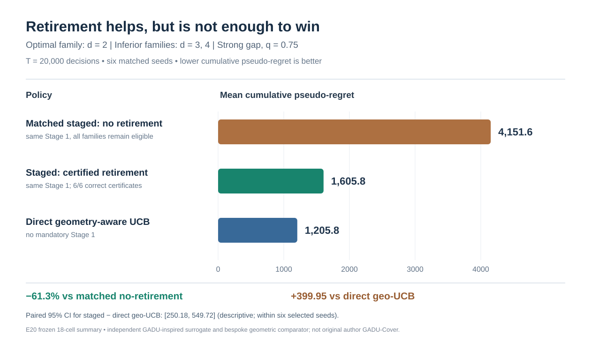
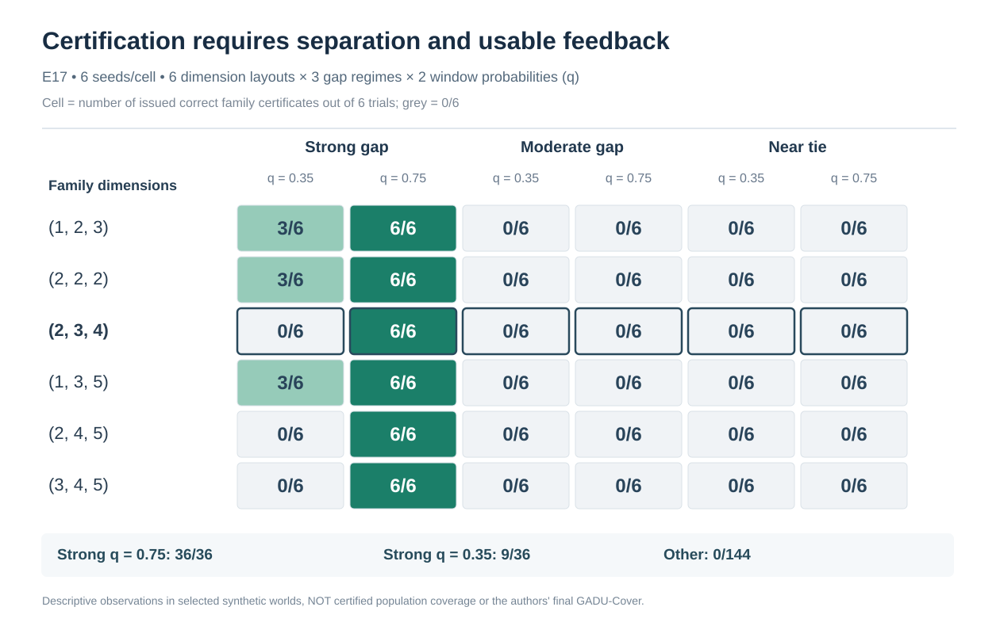
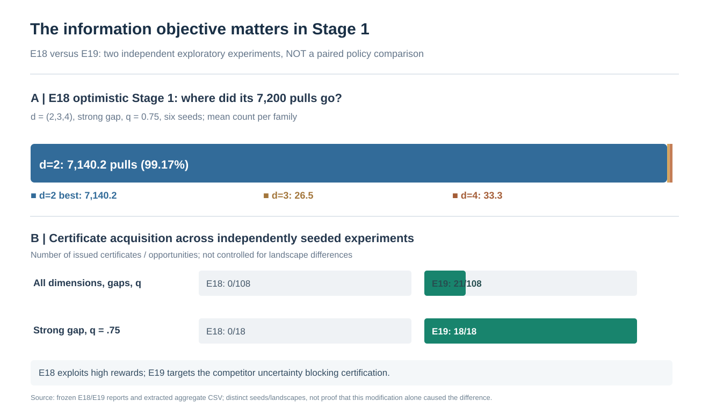
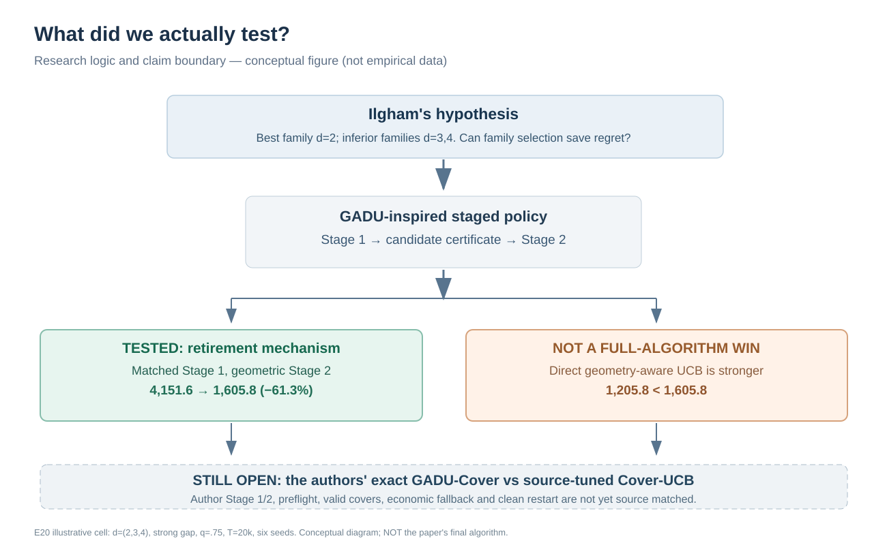

# Publication figure guide and paper-ready draft captions

**Scope:** publication-*formatted* vector assets, not publication-*approved* results. All numerical figures reflect exploratory synthetic **GADU-inspired surrogate** experiments, *not* the author's final GADU-Cover. Do not include them in the WWW paper without Ilgham's scientific review.

## Figure 1 — primary result

[SVG](figures/fig1_main_result_d234_regret.svg) · Source: [E20 18-cell CSV](data/E20_18cell_summary.csv) and [Table 1](tables/table1_main_numbers.md).

**Suggested caption (English):** *Family retirement reduces cumulative latent pseudo-regret compared with a matched staged optimizer but does not outperform direct geometry-aware UCB. In the synthetic d=(2,3,4) setting with the best family at d=2, strong reward separation, q=0.75 and T=20,000, six paired seeds gave mean regrets of 4,151.6 (mandatory Stage1 plus geometric Stage2 without retirement), 1,605.8 (identical Stage1 with certified retirement), and 1,205.8 (direct bespoke geometry-aware UCB). Retirement saved 61.3% versus the matched staged control, while the staged procedure remained 399.95 worse than direct UCB (conditional unadjusted paired 95% CI [250.18, 549.72]). These policies are independent surrogates, not source-matched author GADU-Cover.*

**Must not claim:** This figure shows an end-to-end win over the author's tuned immediate Cover-UCB; the three bars are *not* full regret-over-time curves.

## Figure 2 — where certification is observed

[SVG](figures/fig2_certification_map.svg) · Source: [E17 36-cell CSV](data/E17_36cell_summary.csv).

**Suggested caption (English):** *Observed correct family certifications across dimensions, reward separation and informative feedback (E17). Each cell reports the number of certificates among six independent seeds at T=30,000. In strong-gap cells, q=0.75 yields 36/36 certificates across six dimension layouts, versus 9/36 at q=0.35. Medium-gap and near-tie cells yield no certificates. Frequencies are descriptive for these frozen synthetic worlds and do not establish uniform certificate coverage or the performance of original GADU-Cover.*

**Must not claim:** 36/36 is an estimate of universal success probability; compare across E17/E20 as if matched seeds.

## Figure 3 — why Stage1 exploration objectives matter

[SVG](figures/fig3_stage1_adaptation.svg) · Source: [E18/E19 frozen-report aggregates](data/E18_E19_report_aggregates.csv).

**Suggested caption (English):** *An optimistic reward-seeking Stage1 can starve evidence from rival families (E18), whereas a certificate-gap-directed rule (E19) restores observed certification in an independent exploratory cohort. For d=(2,3,4), strong gap, q=0.75, E18 allocated on average 7,140.2 of 7,200 Stage1 pulls to the best-looking family, leaving just 26.5 and 33.3 to the two rivals. E18 issued 0/108 certificates over its full design. E19 issued 21/108, including 18/18 in strong-gap q=0.75 settings; because seed/landscape draws differ across E18 and E19, this figure is not a paired causal algorithm comparison.*

**Must not claim:** Relative E18/E19 rates are a controlled causal effect or a test of the authors' new adaptive Stage1.

## Figure 4 — scope of the actual test

[SVG](figures/fig4_research_logic_diagram.svg) · Conceptual diagram, grounded by E20 [Table 1](tables/table1_main_numbers.md).

**Suggested caption (English):** *Experimental logic and inference boundary of the heterogeneous-dimension study. In the illustrative E20 cell d=(2,3,4), explicit retirement benefits the staged algorithm relative to identical Stage1 initialization without retirement, but the staged policy still has higher cumulative pseudo-regret than direct geometry-aware UCB. The definitive author GADU-Cover with preflight, physical-cover certification, economic gating, fallback and clean restart has not yet been source-matched to these results.*

**Must not claim:** Figure 4 is a process diagram of the original GADU source algorithm.

## Figure export and provenance

All four SVG files are **committed and directly previewable in GitHub**. The [GitHub Actions publication workflow](../../.github/workflows/ilgham_publication_figures.yml) checks source hashes, validates main claims and exports PNG (300 dpi-equivalent) and vector PDF copies as **downloadable workflow artifacts**. The binary PNG/PDF variants are *Actions artifacts*, not committed source files; if the export job fails, keep using the committed SVG, and do not advertise binary outputs as available. Provenance: [figure source manifest](data/FIGURE_SOURCE_MANIFEST.md). The static figures do not represent end-to-end on-policy author validation.
